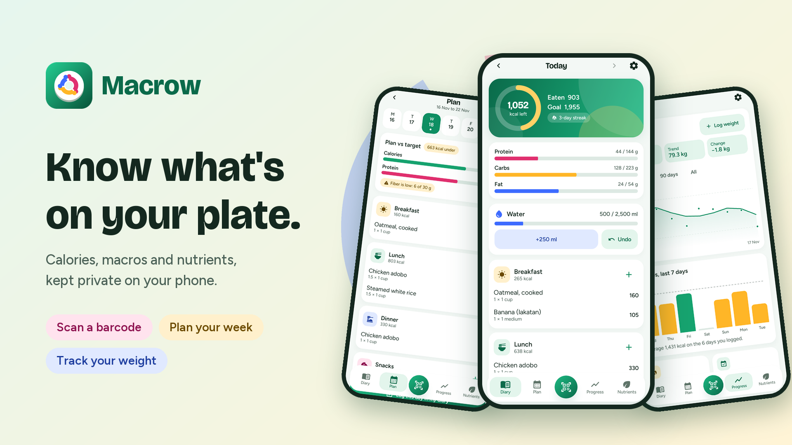

<h1>Macrow</h1>

<b>A calorie and nutrition tracker that keeps your diary, your meal plan and your progress private on your phone.</b>

<h2>About</h2>

Macrow is a food diary for one person. You log what you eat, scan a barcode when you have a packaged food, and see your calories, protein, carbs and fat against a daily target worked out from your own numbers. You plan meals ahead, track your weight, and see which vitamins and minerals you are getting.

Your diary stays on your phone. There is no account, no ads and no tracking. The only time Macrow goes online is when you look up a food in the open Open Food Facts database.

## Features

- **Daily diary.** Log breakfast, lunch, dinner and snacks. A calorie ring shows what is left, with bars for protein, carbs and fat. Go back to any earlier day.
- **Foods ready to use.** About 250 foods come built in: Filipino favorites like adobo, sinigang and pandesal, everyday foods from around the world, and fast food from places like Jollibee, McDonald's, KFC, Chowking, Mang Inasal and Mister Donut, plus street food. Fast food values are estimates: check the box and edit any food to match.
- **Search and scan.** Search your foods, or look one up online. Point the camera at a barcode, or type its numbers, to fill in the nutrition facts. Foods you look up are kept for next time.
- **Nutrition label scanner.** When a product is not in the database, take a photo of its nutrition facts panel (or choose one from your gallery). Macrow reads it on your phone and fills in the food for you to check and save. It copes with a single column, a per serving and per 100 g table, kilojoules and salt.
- **Your own foods and recipes.** Create a food, or build a recipe from ingredients and log one serving of it.
- **Targets that fit you.** Tell Macrow your goal, age, height, weight and activity. It works out your calories and macros, and you can change them any time.
- **Diet coach.** Every day gets a short review: what you ate, how your calories split between protein, carbs and fat, what went well, and what to fix. It points out low protein, high salt, a heavy dinner or too little water, and suggests foods that would help. It runs on your phone from your own numbers.
- **Meal plan.** Plan each day of the week and see how the plan compares with your targets. One tap copies a planned day into your diary.
- **Weight and progress.** Log your weight and watch a trend line. See your last 7 days of calories and your logging streak.
- **Vitamins and minerals.** See fiber, iron, calcium, vitamin C, potassium, sodium and sugar for today or as a weekly average.
- **Water.** Add a glass at a time and track it against your goal.
- **Backup and restore.** Pick a folder and Macrow saves a backup once a day when you open it. Restore from any backup file. Export your diary as a CSV file.
- **Meal reminder.** An optional evening nudge that stays quiet when you already logged dinner.
- **Light and dark.** Macrow starts in light mode. Turn on dark mode in Settings.

## Getting started

1. Install Android Studio and JDK 21, then open this folder.
2. Connect your phone with USB debugging on, or start an Android emulator.
3. Run `gradlew.bat installRelease` in this folder, or press Run in Android Studio.
4. Open Macrow and answer three short questions to get your daily target.
5. Tap the plus next to a meal to add your first food.

## Requirements

- An Android phone with Android 8.0 or newer.
- Internet only when you search or scan a food online. Everything else works offline.
- Camera permission, only if you want to scan barcodes or labels. Pictures are read on the phone and never saved or sent. You can always type the barcode instead.

## Built with

Kotlin, Jetpack Compose with Material 3, Room, DataStore, Navigation Compose, WorkManager, CameraX, ML Kit barcode and text recognition, Open Food Facts, Gradle (Kotlin DSL) with a version catalog. Fonts: Bricolage Grotesque and Figtree (bundled).

## Status

Ready to use.

## License

All Rights Reserved. See [LICENSE](LICENSE).

## Credits

Brand names belong to their owners and are used only to help you find a food. Food data from [Open Food Facts](https://world.openfoodfacts.org), available under the Open Database License. The built-in foods are typical values, not lab results. Calorie and nutrient targets are estimates, not medical advice.
